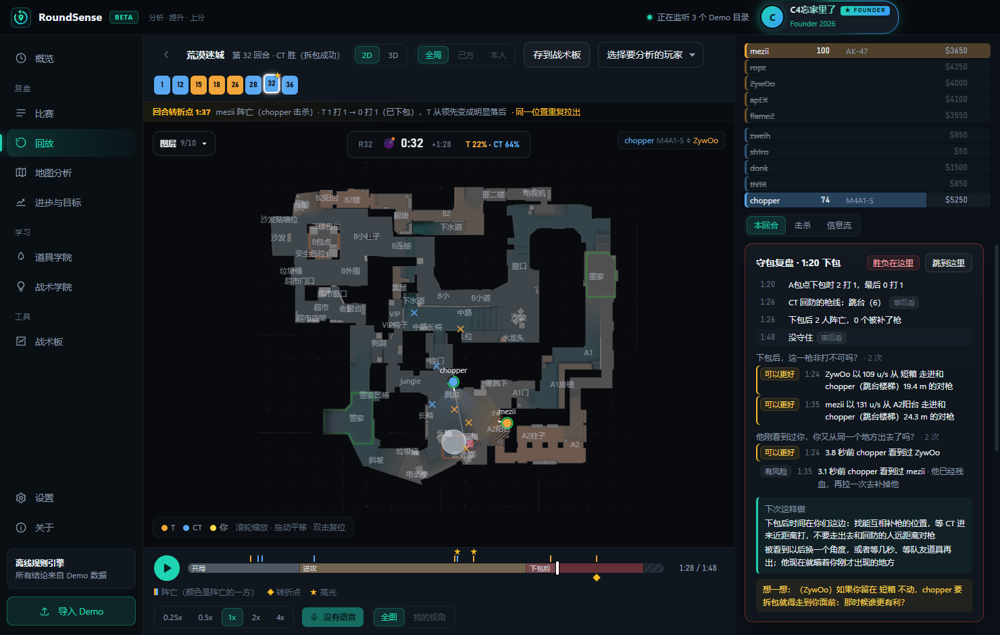
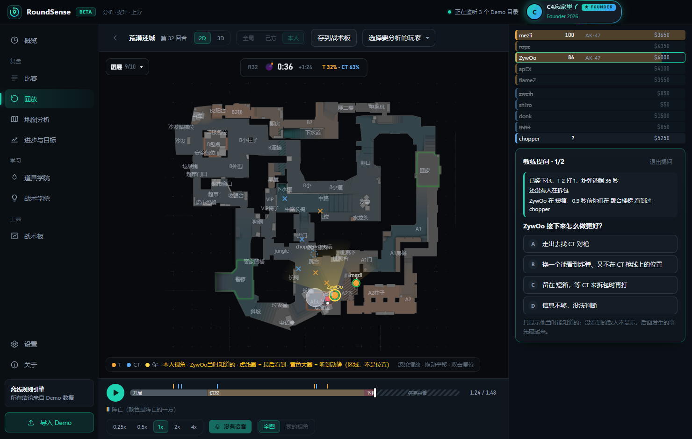
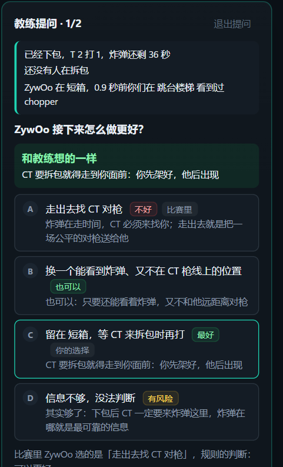
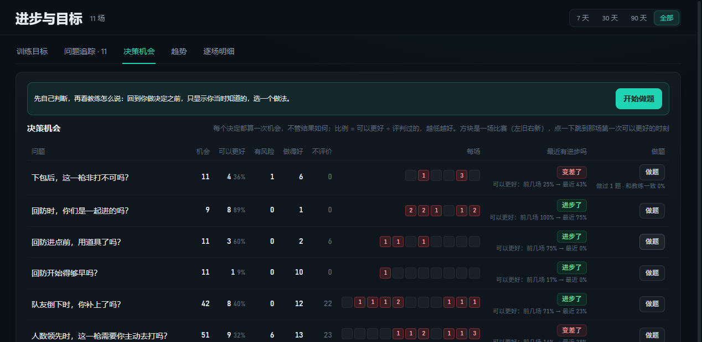
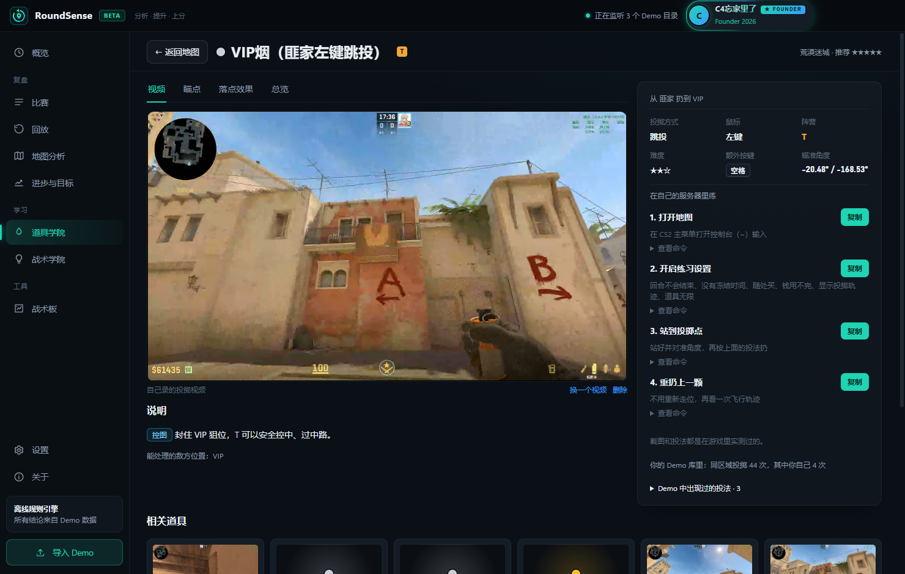
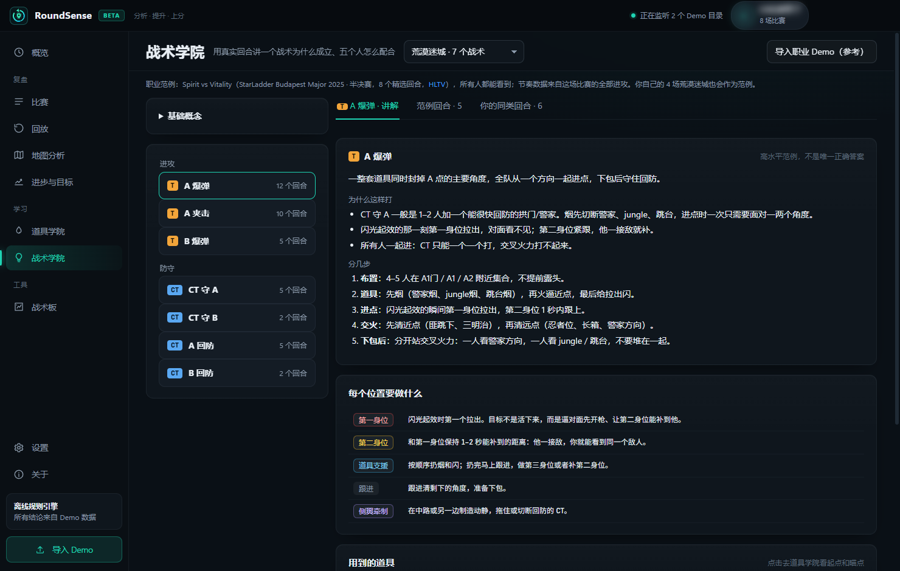
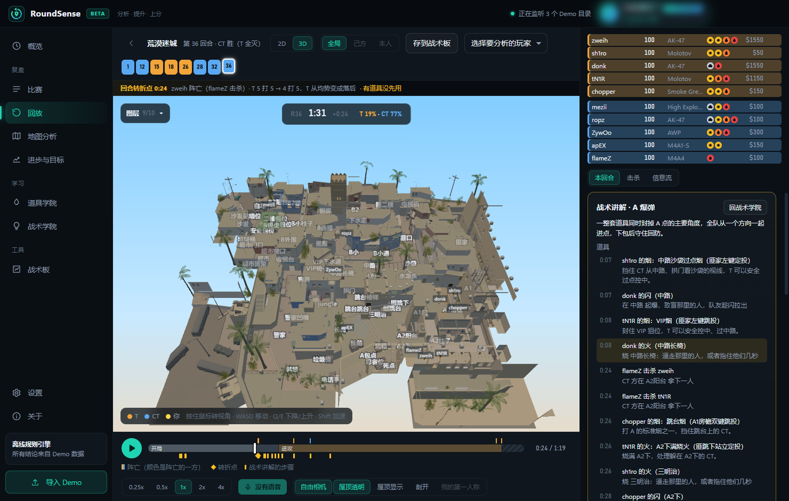
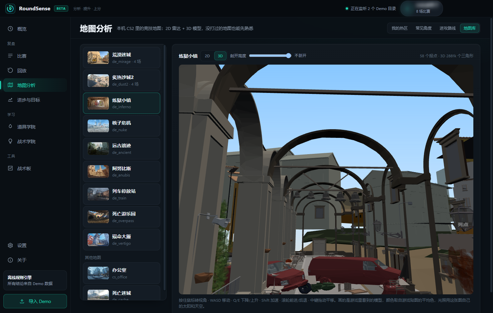

# RoundSense

**CS2 赛后复盘教练：不只告诉你“发生了什么”，还告诉你“输在哪一步、当时该怎么选、下一局盯什么”。**

[English](README.md) | **简体中文**

Windows 桌面应用 · 本地解析 · 免费使用 · 支持完美平台 / 5E / CS2 官方匹配 / FACEIT

## 为什么用 RoundSense

看 Demo 很累：一局 20 多个回合，拖着进度条找“我到底哪里打得不好”，最后往往只记得“对枪输了”。

RoundSense 把这件事反过来：**先告诉你这一回合是在哪个阶段输掉的，再把那个阶段里每一个决定拿出来问你一次。**

- **讲在点上。** 下包后输掉的回合，第一张卡片就是「守包复盘」：CT 从哪里回防、谁走出去和人远距离对枪、最后一个人倒下时炸弹还剩几秒、再拖几秒 CT 就拆不完。不会在你已经守包的时候，还在说“进点时缺一颗闪”。
- **判断公道。** 每条判断都写明检查过哪些情况：出去打断拆包、和队友一起拉、残局保枪……这些都不会被判成错。回合结束后才知道的信息（敌人真实位置、结果）标着“事后看”，只用来解释，不用来评判当时的决定。
- **让你自己先想。** 「教练提问」把你带回做决定之前的那一刻：只显示你当时能知道的，没看到的敌人、回合结果、之后的击杀都藏起来，先选一个做法，再看教练怎么说。
- **看得到进步。** 每个决定都算一次机会，不管结果如何。进步页告诉你“人数领先时主动去拉：51 次机会，可以更好 32%，最近比前几场少了”，而不是“你又犯了 3 次错”。
- **结论有证据。** 所有判断都来自 Demo 数据和确定性的规则，点一下就跳到那一刻。不需要 AI，也不需要联网。

## 教练提问：先自己判断，再看教练怎么说

| 回到做决定之前，只给当时知道的信息 | 选完以后：每个选项的评价、你的选择、比赛里的实际做法 |
|---|---|
|  |  |

现在有 14 类决定会被检查、计数，也都能出成题：

| 阶段 | 问题 |
|---|---|
| 下包后（T 守包） | 这一枪非打不可吗？· CT 开始拆包时，你身上的火用上了吗？ |
| 下包后（CT 回防） | 你们是一起进的吗？· 进点前用道具了吗？· 回防开始得够早吗？ |
| 开局 | 回合第一枪是你主动去拉的，队友能补到你吗？ |
| 任何时候 | 队友倒下时，你补上了吗？· 人数领先时，这一枪需要你主动去打吗？· 他刚看到过你，你又从同一个地方出去了吗？· 拉一个知道有人的角度前，先用道具了吗？· 赢不了的残局，枪保下来了吗？ |
| 进攻 | 第一个进点时，有闪给你开路吗？· 进点时，你们是一起进的吗？ |
| 防守 | 一边空了，最适合补位的你补上了吗？ |

## 进步看比例，不看犯错次数

- 每个问题一行：多少次机会，其中可以更好、有风险、做得好、不评价各几次。
- 每场一个方块，点一下跳到那场第一次可以更好的时刻。
- 前几场和最近几场比，“进步了 / 变差了”一眼就看出来；做题的判断和教练越来越一致，也会显示出来。

## 回放：一屏看清这一回合

- **右侧面板按“这回合输在哪个阶段”排**：决定胜负的那一段排第一、标“胜负在这里”，其他阶段折叠成一行结论。
- **玩家列表固定在最上面**：血量做底色，护甲 / 头盔、手里的枪、身上还有的烟闪火雷、钱，一眼看全；死了就划掉。
- **时间轴分阶段**：开局 → 进攻 → 下包后，上面是阵亡和高光，下面是回合转折点和你的问题。
- **2D / 3D**：本机 CS2 的雷达图和 1:1 地图模型，视野锥、道具、击杀线、烟的真实形状（烟灭火、手雷炸开烟都有）、闪光白屏、C4；可以切到你、阵亡者或击杀者的第一人称。
- **三种视角**：全局真相 / 你们队当时知道的 / 你本人当时知道的，按住按钮看真相。
- **同步播放 Demo 里录到的游戏内语音**，可以只听己方或敌方。
- **一键在 CS2 里打开**这场 Demo 的这一刻，对照着看。

## 死亡复盘：我为什么死？

每次死亡都拆开最后一次对枪：谁先准备好、预瞄偏了几度、反应多快、有没有急停、打中没有、有没有队友能补枪（按队友沿地图实际跑过去要几秒算，不穿墙）。最后给出一个主要原因和“下次这样做”。决策没问题、只是枪法输了，也会直接告诉你“打法不用改，练枪”。

## 学怎么打

| 道具学院 | 战术学院 |
|---|---|
|  |  |

- **道具学院**：9 张竞技图的烟、闪、火、雷。地图上只显示落点，点开看能扔到那里的所有投法。
  - 每个道具：瞄点图、落地效果、投掷视频（陆续补充）、总览；投掷方式、左右键、额外按键、难度。
  - **练习步骤一键复制**：打开地图、练习设置（回合不结束、随处买、显示投掷轨迹、道具无限）、站到投掷点、重扔上一颗。
  - 来源：作者在游戏里实测的精选、游戏自带的官方地图指南、社区常用点位。
- **战术学院**：9 张图共 63 个战术，讲清楚目标、每个位置做什么、用哪些道具，再用 Major 职业比赛的真实回合演示，回放旁边逐段讲解。
- **战术板**：摆人、摆道具、画路线，分步骤；可以从回放的某一刻直接生成，导出给队友。

| 3D 回放（本机 CS2 的地图模型） | 地图库：3D 自由视角 |
|---|---|
|  |  |

## 更多功能

| 功能 | 说明 |
|---|---|
| 自动导入 | 监听完美平台的 Demo 文件夹、CS2 的 `replays` 文件夹和你添加的文件夹，也可以拖进窗口；打完一局会弹出通知 |
| 本场速览 | 结果、Rating、MVP / 战犯，一个最该改的问题、一个值得复盘的回合、一个值得录下来的高光；一键复制成图片 |
| 回合局势 / 防守站位 | 9 张竞技图：进攻发起时队伍在打什么、缺什么，你更合理的职责；CT 开局怎么站、哪块空了、谁最该补位 |
| 地图分析 | 死亡 / 击杀热区、常见角度、进攻路线 |
| 高光时刻 | 3 杀以上、赢下的残局、刀杀，标出录像片段，一键在 CS2 里打开 |
| 训练目标 | 最多 3 个目标，每场自动更新进度 |
| 这条不准 | 觉得哪条判断不对，一键选原因标记掉，它就不再计入统计；还能导出成去掉 SteamID 和昵称的测试样本发给作者，让规则以后不再犯同样的错 |

## 下载与安装

1. 到 [Releases](https://github.com/dylanx1996/roundsense/releases/latest) 下载最新的 **`RoundSense-Setup-X.Y.Z.exe`**。
2. 运行安装程序：选择语言（中文 / English）、阅读并同意用户协议、选择安装位置。不需要管理员权限。
3. 第一次打开会有新手引导，教你在各个平台怎么下载 Demo。

**系统要求**：Windows 10 / 11（64 位）。建议装好 Steam 版 CS2：雷达底图、地图图片和 3D 地图都从本机的 CS2 读取，本软件不分发任何游戏资源。没装 CS2 也能分析，只是没有这些画面。

**升级**：点标题栏右上角的「检查更新」，有新版本时点「立即更新」，下载完点「重启并更新」即可。你的数据保存在 `%APPDATA%\RoundSense`，更新和卸载都不会删除。以前用 zip 版的，下载安装包装一次就行，数据会自动沿用。

## 怎么拿到比赛 Demo

| 平台 | 怎么下载 | 导入方式 |
|---|---|---|
| **完美平台** | 完美客户端 → 比赛记录 → 下载 Demo | 自动导入（会一直监听 `%APPDATA%\Wmpvp\demo`） |
| **5E 平台** | 5E 客户端 / 官网 → 比赛记录 → 下载 DEMO | 把下载文件夹加入监听，之后自动导入 |
| **CS2 官方匹配** | 游戏内「观看 → 你的比赛 → 下载」 | 自动导入 |
| **FACEIT / 其他** | 下载 `.dem` / `.dem.zst` / `.dem.gz` / `.zip` | 拖进窗口，或者放进监听的文件夹 |

## 安全与隐私

- **不碰游戏进程**：只读取 Demo 文件和 CS2 安装目录里的地图资源。不读内存、不注入、不抓包，比赛中不显示任何东西，和 VAC / 反作弊无关。
- **数据都在本机**：Demo、分析结果、比赛记录都保存在本机，所有解析都在本机完成。点“检查更新”或者勾选了“每天自动检查一次”时，会向 GitHub 查询最新版本号，查询不带任何数据。
- **用户体验改进计划（可选，默认不参加）**：你明确同意后，软件每天最多发送一次使用统计——一个随机安装编号、软件版本和界面语言，用来统计使用的设备数量和版本。编号保持不变，所以是去标识化而不是完全匿名的统计；不发送 Demo、比赛数据、SteamID、昵称、文件路径或 AI 密钥。统计服务运行在 Cloudflare（美国），记录约 400 天后自动删除；随时可以在「关于」里退出，退出时会请求删除你的记录。详见 [隐私政策](PRIVACY.zh-CN.md)。
- **AI 可选**：所有分析都不需要 AI。开启后只发送这次分析需要的结构化数据，不发送 Demo、文件路径或账号信息。

## 反馈与支持

- 遇到问题或者有建议：在软件里「关于 → 反馈问题」填好，会在浏览器里打开一个填好的 Issue。也可以直接 [新建 Issue](https://github.com/dylanx1996/roundsense/issues/new)。
- 软件里「关于 → 支持作者」可以请作者喝杯咖啡。不打赏也完全不影响使用，所有功能永远免费。赞助的朋友可以领取纯外观的赞助者礼包：3D 回放里的专属 CT / T 人物模型、全息赞助者名片、4 款限定主题、标题栏流光名牌、分享图专属边框。

## 语言

界面有简体中文和英文：第一次打开的新手引导里就能选，以后在「设置 → 语言与外观」里切换。英文版里的报点用英语玩家自己的叫法。

## 许可

RoundSense 可以免费下载、免费使用，但不是开源软件：源代码不公开，也没有以开源许可证授权。使用条款见 [用户许可协议](EULA.zh-CN.md)，个人信息的处理见 [隐私政策](PRIVACY.zh-CN.md)，第三方组件见 [THIRD_PARTY_NOTICES.md](THIRD_PARTY_NOTICES.md)。

RoundSense 是独立开发的第三方复盘软件，与 Valve Corporation 无隶属、赞助、授权或认可关系。Counter-Strike 及相关名称、商标和游戏资产归各自权利人所有。

Copyright © 2026 Dylan Su. All rights reserved.

© 2026 dylan su。Counter-Strike、CS2 是 Valve Corporation 的商标。本项目与 Valve、完美世界、5EPlay 无关联。
